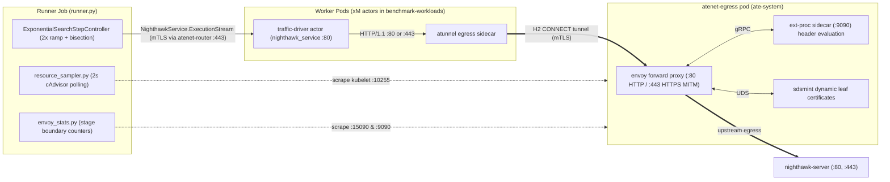
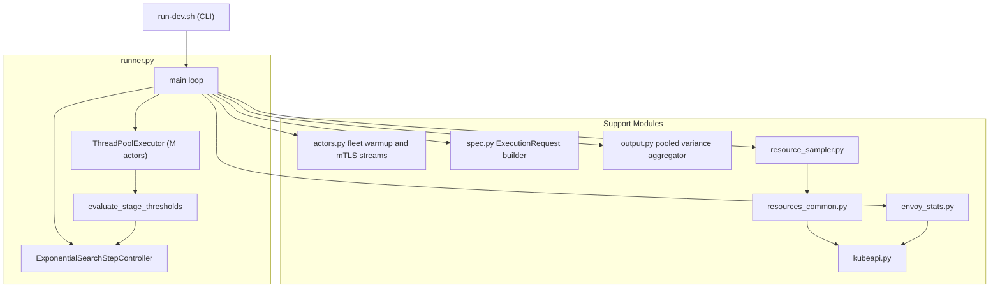
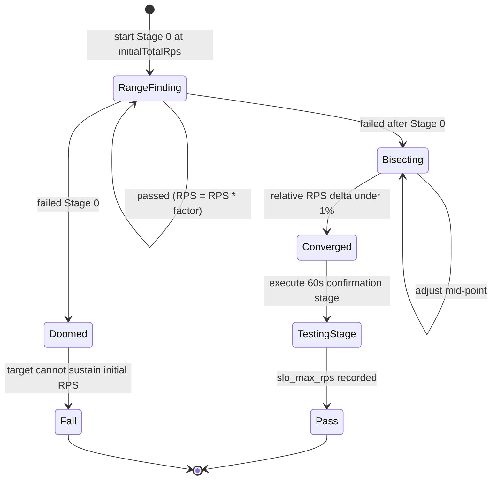

# Nighthawk Egress-Capacity Benchmark

## Objective

Measure the scale and performance of Agent Substrate's egress gateway
(`atenet-egress`). The concrete measurement, per CPU configuration:

> **What is the maximum request rate the egress path sustains while tail
> latency stays under the SLO?**

The benchmark determines that capacity using an adaptive load driver:
it ramps open-loop load until a threshold breaks, bisects the boundary, and
confirms with a 60s testing stage. Run it across `envoyCpu` and `extProcCpu`
configurations to map throughput, or continuously to prevent networking
regressions.

The SLO bounds latency **mean+2σ** (~p95 proxy for bell-shaped distributions).
True p50, p90, p95, and p99 percentiles are reported per stage, while mean+2σ
gates the adaptive search.

## What It Measures

Every benchmark request exercises the complete production egress dataplane:
sandboxed actors running inside gVisor, `atunnel` HTTP/2 `CONNECT` transport,
the `atenet-egress` Envoy proxy, out-of-process policy inspection in `ext-proc`,
and certificate minting via `sdsmint`:



Client-measured latency covers the round-trip from the actor socket through
`atunnel`, the H2 tunnel hop, `atenet-egress` Envoy processing, `ext-proc`
policy checks, upstream connection dispatch to `nighthawk-server`, and the
HTTP response return path.

### Protocol Modes

- `--mode http`: Plaintext HTTP forward proxy through `atenet-egress:80`.
  Envoy terminates the actor's connection and calls `ext-proc` on request
  headers.
- `--mode https-mitm`: Two-stage TLS termination through `atenet-egress:443`.
  The actor initiates TLS to the target hostname using the cluster's egress
  MITM CA bundle. `atenet-egress` intercepts the handshake, requests a dynamic
  leaf certificate from `sdsmint`, runs `ext-proc` header inspection, and
  originates a new TLS connection to the destination with `servicedns` validation.
- `--conn-mode keepalive`: Multiplexed persistent HTTP/1.1 connections.
- `--conn-mode churn`: Single-request connections (`max_requests_per_connection: 1`)
  measuring connection setup, TLS handshakes, and socket teardown overhead.

### Threshold Table

Capacity requires all three thresholds to hold simultaneously:

| Threshold | Guards against | Failure symptom |
|---|---|---|
| `tailLatencySloMs` (mean+2σ ≤ X ms) | Gateway queueing delays | Envoy buffers fill, event loop delays push tail latency above SLO |
| `successRateThreshold` (default: 0.998) | Dropped or rejected requests | 503 errors from pool overflow, 504 timeouts from backend stalls |
| `sendRateThreshold` (default: 0.9) | Client harness saturation | Event loop pacing stalls when socket buffers or connections exhaust |

## Dataplane and Runner Architecture

The benchmark executes as a Kubernetes Job running `runner.py`:



## Saturation Attribution and Telemetry

The telemetry subsystem captures infrastructure resource consumption and
gateway counters across test stages to attribute performance bottlenecks.
`atenet-egress` listens on `:443` for Stage 1 mTLS `CONNECT` (unwrapping to
cleartext `:80` or TLS MITM `:443`); `ext-proc` serves gRPC on `:50051` and
metrics on `:9090`.

- **cAdvisor Polling**: `resource_sampler.py` polls `/api/v1/nodes/<node>/proxy/metrics/cadvisor`
  in Prometheus text format via the Kubernetes API server every 2 seconds,
  collecting CPU rate and memory working set for `egress` (`envoy`, `ext-proc`, `sdsmint`),
  `atelet` (`atelet`, `objectstore-plugin`), `runner`, `workers`, and `server`.
- **Gateway Stage Boundaries**: `envoy_stats.py` scrapes Envoy
  `:15090/stats/prometheus` and `ext-proc` `:9090/metrics` before and after each
  stage, computing counter deltas for:
  - `http.<prefix>.downstream_rq_2xx`: 2xx responses on ingress and MITM HTTP listeners.
  - `listener.<addr>.ssl_handshake`: TLS handshakes completed per listener address.
  - `cluster.<name>.upstream_rq_total`: Total requests proxied per upstream cluster.
  - `cluster.<name>.upstream_cx_overflow`: Connection pool overflow drops.
  - `server.memory_allocated`: Envoy heap memory allocation gauge.
  - `ext_proc.process_cpu_seconds_total`: CPU consumption of the ext-proc container.
  - `ext_proc.process_resident_memory_bytes`: Resident set size of the ext-proc container.
- **Saturation Diagnosis**: `output.py` marks `gateway_saturated: true` when
  `max(envoy_cpu_util, ext_proc_cpu_util) >= 0.80` while
  `max(worker_max_cpu_util, origin_max_cpu_util) < 0.80`.

## Key Design Decisions

### 1. Direct ExecutionStream Over mTLS

Stock `nighthawk_adaptive_load_client` cannot inject substrate routing headers
(`ate-target-actor`) into gRPC metadata, nor can it fan out a single load
schedule across `M` independent actor containers.

Instead, `runner.py` drives the adaptive search loop in Python and invokes
`NighthawkService.ExecutionStream` on stock `nighthawk_service` processes
inside `M` warm `traffic-driver` actors. Communication traverses `atenet-router`
over port 443 with SPIFFE mTLS:

```python
# actors.py
stream_rpc = router_channel.stream_stream(
    "/nighthawk.client.NighthawkService/ExecutionStream",
    request_serializer=lambda req: req.SerializeToString(),
    response_deserializer=lambda b: b,
)
metadata = [
    ("ate-target-actor", f"{atespace}/{actor_name}"),
]
```

This keeps the actor container on unmodified upstream images
(`envoyproxy/nighthawk-dev`) without bespoke proxy daemons.

### 2. Right-Sized Connection Pools

High-rate open-loop tests can cause connection storms at stage start. `spec.py`
sizes connection pools per event loop:

- `conn_mode == "keepalive"`: Defaults to 32 connections per worker loop to avoid
  initial TLS handshake spikes during steady multiplexing.
- `conn_mode == "churn"`: Sets 250 connections per loop and
  `max_requests_per_connection: 1` to sustain connection churn without
  premature pool overflow.

[`spec.build_command_line_options_dict`](spec.py) configures connection limits,
open-loop request pacing, and TLS transport socket settings for each stage.

### 3. Step Controller State Machine

`ExponentialSearchStepController` mirrors Nighthawk's native C++ adaptive
controller:



- **Stage 0 Failure**: If Stage 0 fails thresholds, `is_doomed()` aborts the run
  immediately instead of wasting time bisecting an unachievable starting rate.
- **Convergence**: Bisection stops when the relative difference between
  successive RPS values drops below 1 percent (`convergence_threshold = 0.01`).
- **Testing Stage**: Runs for 60 seconds at `best_clean_rps` to evaluate boundary
  stability. Transitions to `Pass` once `slo_max_rps` is recorded from the
  converged search. `testing_passed` records whether the 60s boundary stage
  stayed below all thresholds, while `Doomed` or deadline expiry transitions
  to `Fail`.

### 4. Pooled Latency Variance Across Actors

When driving load across `M` parallel actors, combining latencies by averaging
per-actor mean values produces statistical error.

[`output.aggregate_multi_actor_stage`](output.py) applies parallel-group pooled
variance across actor sample counts and latencies to compute the true multi-actor
mean and standard deviation without averaging errors. Stage achieved RPS divides
total sent requests across all actors by the measured stage execution duration.

### 5. Saturation Attribution

`resource_sampler.py` polls kubelet cAdvisor metrics every 2 seconds during the
run. At stage boundaries, `envoy_stats.py` scrapes Envoy (`:15090/stats/prometheus`)
and `ext-proc` (`:9090/metrics`).

`output.py` inspects peak utilization across components during the testing stage:

- `gateway_saturated`: Evaluates to `true` when
  `max(envoy_cpu_util, ext_proc_cpu_util) >= 0.80` while
  `max(worker_max_cpu_util, origin_max_cpu_util) < 0.80`.
- `bottleneck_component`: Attributes saturation to `"envoy"`, `"ext-proc"`,
  `"envoy+ext-proc"`, `"worker"`, `"origin"`, or `"none"`.

## How to Run It

### On a Dev Cluster

Deploy substrate and workload prerequisites:

```bash
# Sourced from .ate-dev-env.sh
go run ./cmd/ate-setup deploy ate-system \
  --credential-provider='{"name":"k8s.io"}' \
  --ingress-allowed-spiffe-ids=spiffe://cluster.local/ns/benchmarking/sa/benchmark-runner

WORKLOAD_TEMPLATES="sleep traffic-driver" ./benchmarking/workloads/deploy.sh \
  --deploy \
  --worker-count 4 \
  --sandbox-class gvisor \
  --actor-cpu 4 \
  --actor-memory 2Gi
```

Run the development benchmark script:

```bash
./benchmarking/nighthawk-egress/run-dev.sh \
  --envoy-cpu 2 \
  --ext-proc-cpu 2 \
  --actors 4 \
  --mode http \
  --conn-mode keepalive \
  --tail-latency-slo-ms 25
```

Flags supported by `run-dev.sh`:

- `--envoy-cpu N`: Envoy CPU allocation and worker threads.
- `--ext-proc-cpu N`: Ext-proc CPU allocation.
- `--actors M`: Number of parallel `traffic-driver` actors.
- `--mode {http,https-mitm}`: Target protocol mode.
- `--conn-mode {keepalive,churn}`: Connection lifecycle mode.
- `--tail-latency-slo-ms MS`: Tail latency SLO target in milliseconds.
- `--dest GS_PATH`: Google Cloud Storage upload destination.

### Reading the Results

Artifacts save to the directory specified by `--dest` or local output path:

| File | Contents |
|---|---|
| `capacity.json` | Final verdict, `slo_max_rps`, `gateway_saturated`, `bottleneck_component`, latency percentiles, and CPU utilization. |
| `stats.jsonl` | Per-stage execution metrics: attempted and achieved RPS, send rate, success rate, error counts, pooled latency, and failed thresholds. |
| `resources-by-stage.json` | Mean, peak, and p95 CPU and memory utilization aggregated by stage for Envoy, ext-proc, workers, and test server. |
| `resources-raw.jsonl` | Raw 2-second periodic cAdvisor samples collected during the run. |
| `envoy-stats.json` | Prometheus counter deltas scraped from Envoy :15090 and ext-proc :9090 at stage boundaries. |
| `results.json` | Full stage output array for all adjusting stages and testing stage. |
| `status.json` | High-level execution status, error messages, and actor count. |
| `logs.txt` | Runner execution logs. |

## Configuration Knobs

CLI arguments supported by `runner.py` (a subset is exposed by `run-dev.sh` flags):

| Flag | Default | Description |
|---|---|---|
| `--envoy-cpu` | 2 | CPU request and limit for Envoy; sets `--concurrency`. |
| `--ext-proc-cpu` | same as envoy | CPU request and limit for the `ext-proc` sidecar container. |
| `--mode` | `http` | Protocol mode: `http` or `https-mitm`. |
| `--conn-mode` | `keepalive` | Connection mode: `keepalive` or `churn`. |
| `--actors` | 1 | Number of warm `traffic-driver` actors driving load. |
| `--client-concurrency` | 4 | Event loops per actor container. |
| `--connections` | 32 / 250 | Connections per event loop (32 for keepalive, 250 for churn). |
| `--max-pending-requests` | 1000 | Maximum pending request queue per loop. |
| `--initial-total-rps` | 1000 | Initial aggregate RPS for Stage 0 across all actors. |
| `--exponential-factor` | 2.0 | Multiplier for exponential search ramp. |
| `--measuring-period-s` | 20 | Duration of each adjusting stage in seconds. |
| `--convergence-deadline-s` | 600 | Maximum time allowed for bisection to converge in seconds. |
| `--testing-stage-duration-s` | 60 | Confirmation run duration at converged RPS in seconds. |
| `--success-rate-threshold` | 0.998 | Minimum fraction of successful 2xx responses. |
| `--send-rate-threshold` | 0.9 | Minimum fraction of scheduled requests sent. |
| `--tail-latency-slo-ms` | 25.0 | Maximum allowed mean+2σ latency in milliseconds. |
| `--atespace` | `benchmark-workloads` | Atespace holding benchmark actors. |

## Sizing and Troubleshooting

To ensure the benchmark measures `atenet-egress` rather than test harness
limitations:

- **Worker Sizing**: Set adequate worker and actor CPU allocation. Actors
  generate network load and process TLS handshakes; under-provisioned actor
  pods will bottleneck before the gateway saturates.
- **Client Harness Saturation**: If `send-rate` falls below `0.9` during early
  stages, check if actor CPU is pegged. Raise `actors` or worker CPU allocation.
- **Backend Saturation**: Scale `nighthawk-server` replicas to `max(envoyCpu, 2)`
  to prevent the echo server from becoming the bottleneck.
- **Diagnosis via `capacity.json`**: Inspect `bottleneck_component`. If it reports
  `"worker"` or `"origin"`, increase worker or server resources before
  attributing capacity limits to the gateway.

---

## Manual Standalone Invocation

For interactive debugging without the automated runner, you can deploy the
target server and traffic driver actor manually using standalone scripts.

### 1. Prerequisites

Deploy substrate with ingress permissions for the test runner:

```bash
go run ./cmd/ate-setup deploy ate-system \
  --credential-provider='{"name":"k8s.io"}' \
  --ingress-allowed-spiffe-ids=spiffe://cluster.local/ns/nighthawk/sa/default
```

Provision the cluster trust bundle so the egress gateway trusts test
certificates:

```bash
hack/setup-e2e-egress-tls-kind.sh
```

Ensure `kubectl-ate` is installed:

```bash
go install ./cmd/kubectl-ate
```

### 2. Deploy Server and Invoker

Deploy `nighthawk-server` and `traffic-driver-invoker` into the `nighthawk`
namespace:

```bash
./benchmarking/nighthawk-egress/deploy.sh
```

### 3. Deploy Traffic Driver Actor

Deploy the worker pool, actor template, and `nighthawk/tester` actor:

```bash
./benchmarking/nighthawk-egress/deploy-traffic-driver.sh
```

### 4. Port-Forward and Run

In a separate terminal, forward local port 19980 to the invoker service:

```bash
kubectl -n nighthawk port-forward svc/traffic-driver-invoker 19980:19980
```

Run `nighthawk_client` locally against the port-forwarded endpoint:

```bash
docker run --rm --network=host --entrypoint /usr/local/bin/nighthawk_client \
  envoyproxy/nighthawk-dev@sha256:7729902afea9d83f593b240690ba7d6e8fff04f6215ada538cfb4c1452b2553e \
  --nighthawk-service grpc://127.0.0.1:19980 \
  --rps 1000 \
  --concurrency 1 \
  --protocol http1 \
  --duration 60 \
  http://nighthawk-server.nighthawk.svc:80
```

Target URLs by mode:

| Egress Mode | Target URL | Port |
|---|---|---|
| Plaintext HTTP | `http://nighthawk-server.nighthawk.svc:80` | 80 |
| HTTPS (TLS MITM) | `https://nighthawk-server.nighthawk.svc:443` | 443 |
| TLS Passthrough | `https://nighthawk-server.nighthawk.svc:8443` | 8443 |

### 5. Manual Cleanup

Delete the actor, template, and worker pool:

```bash
./benchmarking/nighthawk-egress/deploy-traffic-driver.sh --delete
```

Delete the server and invoker:

```bash
./benchmarking/nighthawk-egress/deploy.sh --delete
```

Delete the remaining namespace:

```bash
kubectl delete namespace nighthawk
```
