# Nighthawk Egress Benchmark

Benchmarks the Agent Substrate egress dataplane (`atunnel` -> `atenet-egress`) using [Nighthawk](https://github.com/envoyproxy/nighthawk).

## Objective

For each egress mode, the benchmark finds the highest request rate that one `atenet-egress` replica carries for one actor while every threshold holds. `envoy` and `ext-proc` of that replica get `envoyCpu` CPUs each.

The search is the adaptive mode of Nighthawk, as in the [nighthawk-ingress benchmark](../nighthawk-ingress/README.md#objective).

## What it measures

```mermaid
flowchart LR
    subgraph job["Runner Job"]
        client["Nighthawk client"]
        invoker["invoker sidecar<br/>(:19980, adds ate-target-actor)"]
    end
    router["atenet-router"]

    subgraph worker["WorkerPod (ateworker-gvisor)"]
        atunnel-ingress["ingress atunnel"]
        actor["Actor: nighthawk/tester<br/>(nighthawk_service :80)"]
        atunnel-egress["egress atunnel"]
    end

    egress["atenet-egress<br/>(HTTP / HTTPS MITM / TLS passthrough)"]
    server["nighthawk-server<br/>(:80, :443, :8443)"]

    client -->|"start test"| invoker
    invoker -->|"gRPC + ate-target-actor: nighthawk/tester"| router
    router --> atunnel-ingress
    atunnel-ingress --> actor
    actor ==>|"test traffic"| atunnel-egress
    atunnel-egress ==>|"mTLS"| egress
    egress ==> server
```



The test traffic starts in `nighthawk_service` inside the actor. It passes the egress `atunnel` of the worker pod and `atenet-egress` on the way to `nighthawk-server`. The runner Job only starts each stage of the search.

Each suite uses one egress mode, and the mode sets the target URL:

| `mode` | Egress Mode | Target URL | Port |
|---|---|---|---|
| `http` | Plaintext HTTP | `http://nighthawk-server.nighthawk.svc:80` | `80` |
| `mitm` | HTTPS (TLS MITM) | `https://nighthawk-server.nighthawk.svc:443` | `443` |
| `passthrough` | TLS Passthrough | `https://nighthawk-server.nighthawk.svc:8443` | `8443` |

A stage fails when the success rate is below 0.998, the send rate is below 0.9, or the latency mean plus two standard deviations is above 25 ms. A request that is in flight when a stage ends counts as sent and not as successful, so the success rate reads below 1.0 when no request failed.

## How it works

One Kubernetes Job per `type: nighthawk-egress` tests.yaml entry, driven by [`../automation/orchestrator.py`](../automation/orchestrator.py). For each suite the orchestrator deploys Substrate, then:

1. **Pin the gateway.** The orchestrator pins `deployment/atenet-egress` to 1 replica with `envoy` and `ext-proc` at `envoyCpu` cores each, and waits for the rollout.
2. **Deploy the rig.** `hack/setup-e2e-egress-tls-kind.sh` provisions the CA bundle so `atenet-egress` trusts the certificate of `nighthawk-server`. `deploy.sh` and `deploy-traffic-driver.sh` deploy `nighthawk-server`, the worker pool, the actor template, and the `nighthawk/tester` actor with its egress policy.
3. **Adaptive search.** The orchestrator submits one Job from `nighthawk-egress-runner-job.yaml.tmpl`. In the Job, `runner.py` builds the load spec for the mode (`spec.py`) and runs `nighthawk_adaptive_load_client` against `nighthawk_service` in the `nighthawk/tester` actor, through the `invoker` sidecar of the Job. The sidecar is an Envoy that adds the `ate-target-actor: nighthawk/tester` header and connects to `atenet-router` as `benchmarking/benchmark-runner`. The search starts at 500 requests per second in total, which Nighthawk rounds down to 31 for each of the 16 workers, 496 in total. Each worker has 16 connections. The search doubles the rate in 20 s stages until a stage fails a threshold, then narrows the range, and ends with one 60 s testing stage. The stages before the testing stage have a deadline of 600 s in total.
4. **Upload results** (see [Reading the results](#reading-the-results)). The Job fails when the adaptive client exits non-zero, its output has no testing stage, the runner raises an error, or an upload fails. The client exits non-zero and writes no output when a stage ends with an error, the first stage fails a threshold, or the search passes its deadline. The runner uploads the files that exist before it exits.

## How to run it

### In CI

[`benchmarking/automation/tests.yaml`](../automation/tests.yaml) holds three `type: nighthawk-egress` suites, one for each gateway mode: `egress_gatewaycap_http_1cpu`, `egress_gatewaycap_mitm_1cpu`, and `egress_gatewaycap_passthrough_1cpu`. The scheduled job in [benchmarking/automation](../automation/README.md) runs them. They support gVisor only.

An entry sets the mode and `envoyCpu`:

```yaml
- name: egress_gatewaycap_http_1cpu
  type: nighthawk-egress
  targetCluster: dev
  duration: 30m
  nighthawk-egress:
    mode: http
    envoyCpu: 1
```

### Reading the results

The runner uploads these files to `<dest>/runs/<name>/run_date=<date>/run_ts=<ts>/run_tag=<tag>/`:

| File | Content |
|---|---|
| `capacity.json` | The verdict. `slo_max_rps` is the achieved rate of the highest stage that passed every threshold, and `slo_max_stage` names that stage. `binding_threshold` lists the thresholds that failed in any stage. The other keys are those of the [nighthawk-ingress](../nighthawk-ingress/README.md) summary, plus `mode`. The runner writes this file only when the search succeeds. |
| `status.json` | `adaptive_client_exit_code`, `slo_max_rps`, and `failures`, the reasons why the run does not count. An upload failure is in the Job log only. |
| `stats.jsonl`, `results.json` | One record for each stage, and the Nighthawk output as JSON. |
| `spec.textproto`, `output.textproto`, `logs.txt` | The load spec, the raw Nighthawk output, and the client log. |

In the runs so far the `passthrough` search ended on the `send-rate` threshold: `binding_threshold` was `send-rate` alone, and the latency that Nighthawk measures stayed under 25 ms. That latency starts when a request is sent, so it does not count the wait for a free connection.

## Tuning

### Configuration knobs (the `nighthawk-egress:` block)

| Knob | Default | Meaning |
|---|---|---|
| `envoyCpu` | required | CPU request and limit of `envoy` and `ext-proc` in `deployment/atenet-egress`, and the Envoy `--concurrency`. |
| `mode` | required | `http`, `mitm`, or `passthrough`. |

The search values and the thresholds are constants in [`spec.py`](spec.py).

### Sizing the rig

The actor, the worker pool, and `nighthawk-server` are sized to outscale `atenet-egress` with one Envoy worker thread, so a run measures the gateway and not the load generator or the origin server. The sizes target a multi-node benchmark cluster, such as 3 x `c3-standard-22` nodes (22 vCPUs and 88 GiB each):

- `traffic-driver-template.yaml.tmpl` gives the `nighthawk/tester` sandbox 16 vCPUs and 8 GiB, so `nighthawk_service` runs its 16 worker threads without CPU throttling. The suites and the manual example command both use 16.
- `traffic-driver.yaml.tmpl` requests 12 vCPUs and 8 GiB for the worker pod and limits it to 18 vCPUs and 10 GiB. The request fits a `c3-standard-22` node beside the system DaemonSets, and the limit leaves burst room for the actor and the worker's atunnel. The worker pod and `nighthawk-server` request 18 vCPUs together, so the scheduler may place them on the same node; this benchmark accepts that.
- `nighthawk-server.yaml` runs `nighthawk_test_server` with `--concurrency 8` and 6-8 vCPUs, so upstream HTTP and TLS on `:80`, `:443`, and `:8443` do not saturate before the gateway.

## Manual runs

The rig also takes a fixed-rate run from a host, with no runner Job. `nighthawk_client` reaches `nighthawk_service` in the actor through `kubectl-ate proxy actor`.

### Prerequisites

1. **Multi-node benchmark cluster with Agent Substrate deployed**:
   - **Existing cluster** (with `.ate-dev-env.sh` configured):
     ```bash
     go run ./cmd/ate-setup deploy ate-system \
       --credential-provider='{"name":"k8s.io"}' \
       --ingress-allowed-spiffe-ids=spiffe://cluster.local/ns/ate-system/sa/atenet-client
     ```
   - To set the `atenet-egress` Envoy worker thread count (`--concurrency`), prefix the command above with `E2E_ATE_ENVOY_CONCURRENCY=<n>`. `E2E_ATE_ENVOY_CONCURRENCY=1` measures a single Envoy core.
   - Provision the CA bundle in `ate-system` so `atenet-egress` trusts `nighthawk-server`'s `servicedns` certificate on `:443`. The script defaults to a kind context, so name the cluster's context:
     ```bash
     KUBECTL_CONTEXT=<context> hack/setup-e2e-egress-tls-kind.sh
     ```
   - To run on a smaller cluster, lower `requests.cpu` and `requests.memory` in `traffic-driver.yaml.tmpl` and `nighthawk-server.yaml` before deploying.
2. **`kubectl-ate`**: `deploy-traffic-driver.sh` builds it from `./cmd/kubectl-ate` into a temporary directory.
3. **Docker** running locally (used to run `nighthawk_client`).

### Setup

#### 1. Deploy `nighthawk-server`

```bash
./benchmarking/nighthawk-egress/deploy.sh
```

#### 2. Deploy the worker pool, actor template, and `nighthawk/tester` actor

```bash
./benchmarking/nighthawk-egress/deploy-traffic-driver.sh
```

#### 3. Forward a port to the actor

In a separate terminal, forward local port `19980` to `nighthawk_service` in the `nighthawk/tester` actor. `kubectl-ate proxy actor` connects as `spiffe://cluster.local/ns/ate-system/sa/atenet-client`, which is the ID in the deploy command above:

```bash
go run ./cmd/kubectl-ate proxy actor tester -a nighthawk 19980:80
```

### Running the Benchmark

Run `nighthawk_client` against the forwarded port (`grpc://127.0.0.1:19980`), which reaches `nighthawk_service` inside the `nighthawk/tester` actor:

```bash
docker run --rm --network=host --entrypoint /usr/local/bin/nighthawk_client envoyproxy/nighthawk-dev:latest --nighthawk-service grpc://127.0.0.1:19980 --rps 1000 --concurrency 16 --protocol http1 --duration 60  http://nighthawk-server.nighthawk.svc:80
```

Nighthawk multiplies `--rps` by `--concurrency`, so this command targets 16,000 requests per second in total. For this URL a gateway with one Envoy worker thread carries less than that, and `nighthawk_client` stops at the first failed request. Lower `--rps` there.

See [Nighthawk CLI help](https://github.com/envoyproxy/nighthawk#using-the-nighthawk-client-cli) for all command line options. The table in [What it measures](#what-it-measures) lists the target URL of each egress mode.

### Cleanup

Delete the `nighthawk/tester` actor, actor template, atespace, and worker pool:

```bash
./benchmarking/nighthawk-egress/deploy-traffic-driver.sh --delete
```

Delete `nighthawk-server` from `nighthawk`:

```bash
./benchmarking/nighthawk-egress/deploy.sh --delete
```

Neither script deletes the `nighthawk` namespace. Delete it with `kubectl delete namespace nighthawk` after `deploy-traffic-driver.sh --delete`, because the actor, template, and atespace live in the ate API, not in the namespace.
