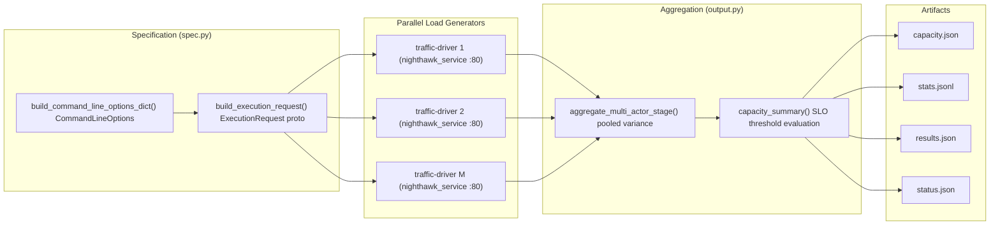
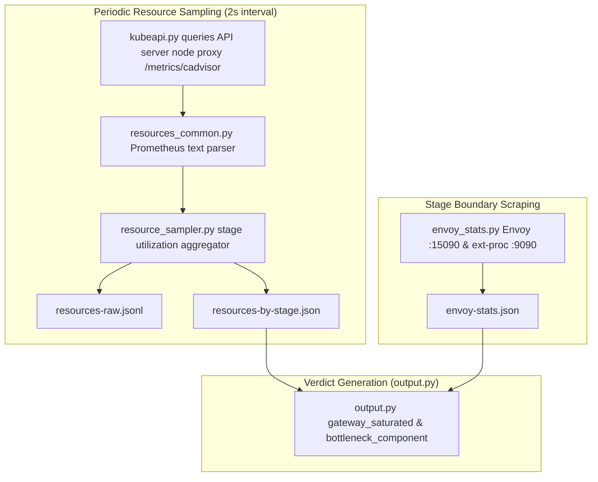

# Nighthawk Egress-Capacity Benchmark

## Objective

Measure the scale and performance of Agent Substrate's egress gateway
(`atenet-egress`). The concrete measurement, per CPU configuration:

> **What is the maximum request rate the egress path sustains while tail
> latency stays under the SLO?**

The benchmark determines that capacity by executing open-loop load stages,
evaluating threshold criteria, and reporting whether tail latency stays
within the target objective.

The SLO bounds latency **mean+2σ** (~p95 proxy for bell-shaped distributions).
True p50, p90, p95, and p99 percentiles are reported per stage, while mean+2σ
gates the capacity determination.

## What It Measures

Every benchmark request exercises the production egress dataplane: sandboxed
actors running inside gVisor, `atunnel` HTTP/2 `CONNECT` transport, and the
`atenet-egress` forward proxy.

### Protocol Modes

- `--mode http`: Plaintext HTTP forward proxy through `atenet-egress:80`.
- `--mode https-mitm`: Two-stage TLS termination through `atenet-egress:443`.
  The actor initiates TLS to the target hostname using the cluster's egress
  MITM CA bundle. `atenet-egress` intercepts the handshake, requests a dynamic
  leaf certificate from `sdsmint`, runs `ext-proc` header inspection, and
  originates a new TLS connection to the destination with `servicedns` validation.
- `--conn-mode keepalive`: Multiplexed persistent HTTP/1.1 connections.
- `--conn-mode churn`: Single-request connections (`max_requests_per_connection: 1`)
  measuring connection setup, TLS handshakes, and socket teardown overhead.

### Threshold Table

Capacity requires all three thresholds to hold simultaneously:

| Threshold | Guards against | Failure symptom |
|---|---|---|
| `tailLatencySloMs` (mean+2σ ≤ X ms) | Gateway queueing delays | Envoy buffers fill, event loop delays push tail latency above SLO |
| `successRateThreshold` (default: 0.998) | Dropped or rejected requests | 503 errors from pool overflow, 504 timeouts from backend stalls |
| `sendRateThreshold` (default: 0.9) | Client harness saturation | Event loop pacing stalls when socket buffers or connections exhaust |

## Dataflow Architecture

`spec.py` generates the execution configuration for Nighthawk load clients.
Responses gathered from `M` parallel actors pass to `output.py` for aggregation:



## Saturation Attribution and Telemetry

The telemetry subsystem captures infrastructure resource consumption and
gateway counters across test stages to attribute performance bottlenecks:



### Telemetry Pipeline Details

- **cAdvisor Polling**: `resource_sampler.py` polls `/api/v1/nodes/<node>/proxy/metrics/cadvisor`
  in Prometheus text format via the Kubernetes API server every 2 seconds,
  collecting CPU rate and memory working set for `egress` (`envoy`, `ext-proc`, `sdsmint`),
  `atelet` (`atelet`, `objectstore-plugin`), `runner`, `workers`, and `server`.
- **Gateway Stage Boundaries**: `envoy_stats.py` scrapes Envoy
  `:15090/stats/prometheus` and `ext-proc` `:9090/metrics` before and after each
  stage, computing counter deltas for:
  - `http.<prefix>.downstream_rq_2xx`: 2xx responses on ingress and MITM HTTP listeners.
  - `listener.<addr>.ssl_handshake`: TLS handshakes completed per listener address.
  - `cluster.<name>.upstream_rq_total`: Total requests proxied per upstream cluster.
  - `cluster.<name>.upstream_cx_overflow`: Connection pool overflow drops.
  - `server.memory_allocated`: Envoy heap memory allocation gauge.
  - `ext_proc.process_cpu_seconds_total`: CPU consumption of the ext-proc container.
  - `ext_proc.process_resident_memory_bytes`: Resident set size of the ext-proc container.
- **Saturation Diagnosis**: `output.py` marks `gateway_saturated: true` when
  `max(envoy_cpu_util, ext_proc_cpu_util) >= 0.80` while
  `max(worker_max_cpu_util, origin_max_cpu_util) < 0.80`.

## Key Design Decisions

### 1. Right-Sized Connection Pools

High-rate open-loop tests can cause connection storms at stage start. `spec.py`
sizes connection pools per event loop:

- `conn_mode == "keepalive"`: Defaults to 32 connections per worker loop to avoid
  initial TLS handshake spikes during steady multiplexing.
- `conn_mode == "churn"`: Sets 250 connections per loop and
  `max_requests_per_connection: 1` to sustain connection churn without
  premature pool overflow.

[`spec.build_command_line_options_dict`](spec.py) configures connection limits,
open-loop request pacing, and TLS transport socket settings for each stage.

### 2. Pooled Latency Variance Across Actors

When driving load across `M` parallel actors, combining latencies by averaging
per-actor mean values produces statistical error.

[`output.aggregate_multi_actor_stage`](output.py) applies parallel-group pooled
variance across actor sample counts and latencies to compute the true multi-actor
mean and standard deviation without averaging errors. Stage achieved RPS divides
total sent requests across all actors by the measured stage execution duration.

## Output Artifact Schemas

The output module formats test executions into standard JSON and JSONL
artifacts:

| File | Contents |
|---|---|
| `capacity.json` | Final verdict, `slo_max_rps`, `gateway_saturated`, `bottleneck_component`, testing stage metrics, and latency percentiles. |
| `stats.jsonl` | One JSON record per stage containing achieved RPS, send rate, success rate, error counts, pooled latency, and failed thresholds. |
| `resources-by-stage.json` | Mean, peak, and p95 CPU and memory utilization aggregated by stage for Envoy, ext-proc, workers, and test server. |
| `resources-raw.jsonl` | Raw 2-second periodic cAdvisor samples collected during the run. |
| `envoy-stats.json` | Prometheus counter deltas scraped from Envoy :15090 and ext-proc :9090 at stage boundaries. |
| `results.json` | Complete array of stage dictionaries including raw per-actor counters and percentiles. |
| `status.json` | High-level execution status, error messages, and stage count. |

---

## Manual Standalone Invocation

For interactive debugging, deploy the target server and traffic driver actor
manually using standalone scripts.

### 1. Prerequisites

Deploy substrate with ingress permissions for the test runner:

```bash
go run ./cmd/ate-setup deploy ate-system \
  --credential-provider='{"name":"k8s.io"}' \
  --ingress-allowed-spiffe-ids=spiffe://cluster.local/ns/nighthawk/sa/default
```

Provision the cluster trust bundle so the egress gateway trusts test
certificates:

```bash
hack/setup-e2e-egress-tls-kind.sh
```

Ensure `kubectl-ate` is installed:

```bash
go install ./cmd/kubectl-ate
```

### 2. Deploy Server and Invoker

Deploy `nighthawk-server` and `traffic-driver-invoker` into the `nighthawk`
namespace:

```bash
./benchmarking/nighthawk-egress/deploy.sh
```

### 3. Deploy Traffic Driver Actor

Deploy the worker pool, actor template, and `nighthawk/tester` actor:

```bash
./benchmarking/nighthawk-egress/deploy-traffic-driver.sh
```

### 4. Port-Forward and Run

In a separate terminal, forward local port 19980 to the invoker service:

```bash
kubectl -n nighthawk port-forward svc/traffic-driver-invoker 19980:19980
```

Run `nighthawk_client` locally against the port-forwarded endpoint:

```bash
docker run --rm --network=host --entrypoint /usr/local/bin/nighthawk_client \
  envoyproxy/nighthawk-dev@sha256:7729902afea9d83f593b240690ba7d6e8fff04f6215ada538cfb4c1452b2553e \
  --nighthawk-service grpc://127.0.0.1:19980 \
  --rps 1000 \
  --concurrency 1 \
  --protocol http1 \
  --duration 60 \
  http://nighthawk-server.nighthawk.svc:80
```

Target URLs by mode:

| Egress Mode | Target URL | Port |
|---|---|---|
| Plaintext HTTP | `http://nighthawk-server.nighthawk.svc:80` | 80 |
| HTTPS (TLS MITM) | `https://nighthawk-server.nighthawk.svc:443` | 443 |
| TLS Passthrough | `https://nighthawk-server.nighthawk.svc:8443` | 8443 |

### 5. Manual Cleanup

Delete the actor, template, and worker pool:

```bash
./benchmarking/nighthawk-egress/deploy-traffic-driver.sh --delete
```

Delete the server and invoker:

```bash
./benchmarking/nighthawk-egress/deploy.sh --delete
```

Delete the remaining namespace:

```bash
kubectl delete namespace nighthawk
```
