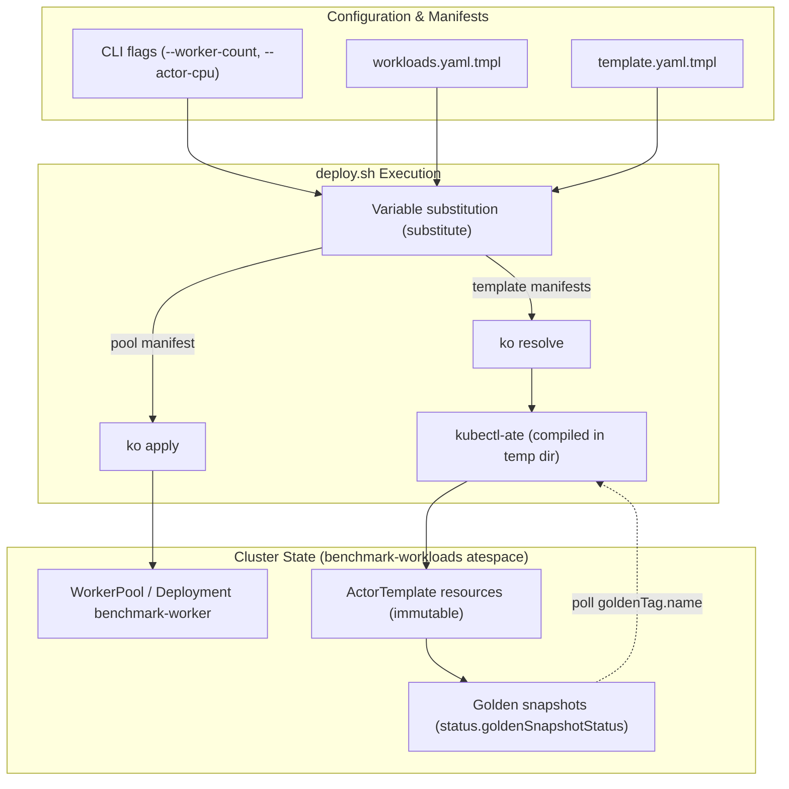

# Benchmark Workloads

`benchmarking/workloads/deploy.sh` provisions the shared `benchmark-worker`
`WorkerPool` and immutable `ActorTemplate` resources in the `benchmark-workloads`
atespace.

## Overview

The benchmark harness tests substrate components under controlled actor
workloads. `deploy.sh` manages the lifecycle of the execution environment:

1. Resolves telemetry configuration from the cluster's `ate-otel-config`
   ConfigMap or `--otlp-endpoint`.
2. Sizes worker pods and actor reservations via CPU and memory flags.
3. Renders and applies the `WorkerPool` manifest via `ko apply`.
4. Waits for the worker deployment rollout or fake worker capacity.
5. Ensures the `benchmark-workloads` atespace exists.
6. Resolves container images and registers `ActorTemplate` resources with the
   ate API via `kubectl-ate`.
7. Polls template readiness until golden snapshots complete.



## Template Catalog

`WORKLOAD_TEMPLATES` controls the templates deployed to the cluster. Unset,
`deploy.sh` deploys `sleep`, `glutton`, `glutton-durdir-data`, and
`glutton-durdir-full`.

| Template | Container Image / Target | Purpose |
|---|---|---|
| `sleep` | `busybox@sha256:1487d0af5f52b4ba31c7e465126ee2123fe3f2305d638e7827681e7cf6c83d5e` | Minimal actor workload with no background CPU or memory activity. |
| `glutton` | `ko://go.ate.dev/substrate/cmd/benchmarking/glutton` | HTTP actor exposing memory allocation and CPU burn endpoints for routing and lifecycle benchmarks. |
| `glutton-durdir-data` | `ko://go.ate.dev/substrate/cmd/benchmarking/glutton` | Glutton actor with durable directory storage mounted at `/var/lib/glutton` for DATA-scope persistence tests. |
| `glutton-durdir-full` | `ko://go.ate.dev/substrate/cmd/benchmarking/glutton` | Glutton actor exercising FULL-scope durable directory commits. |
| `glutton-storage` | `ko://go.ate.dev/substrate/cmd/benchmarking/glutton` | Glutton actor configured with external CSI volumes; requires `STORAGE_CLASS_NAME`. |
| `ate-env` | `${ATE_ENV_IMAGE}` | Diagnostic actor reporting container environment variables, cgroups, and namespace capabilities. |
| `sweperf-*` | Generated images | Software engineering benchmark workloads generated from `sweperf-images.json`. |
| `traffic-driver` | `envoyproxy/nighthawk-dev@sha256:7729902afea9d83f593b240690ba7d6e8fff04f6215ada538cfb4c1452b2553e` | Stock Nighthawk gRPC load client running inside the actor sandbox to benchmark egress networking. |

## Design Decisions

### Immutable Actor Templates

Substrate `ActorTemplate` resources are immutable in the ate API; the service
exposes no update RPC. Any configuration change (such as modifying
`--otlp-endpoint`, switching `--sandbox-class`, or altering `--actor-memory`)
requires deleting the existing template and creating a replacement.

`deploy.sh` deletes the existing template before creating the replacement. Because
benchmark runners terminate actors between test runs, removing old templates does
not disrupt active workloads, and deleting the template removes the superseded
golden actor and snapshot server-side.

### One-Time Build of `kubectl-ate`

Waiting for golden snapshots requires polling each template's status repeatedly.
To avoid compiler overhead from repeated `go run` invocations, `deploy.sh` compiles
`cmd/kubectl-ate` once into a temporary directory at startup and cleans it up via
an `EXIT` trap.

### Go Source Resolution vs. Pinned Third-Party Images

Workload manifests combine Go binaries managed by this repository and third-party
base images:

- Internal Go workloads (`sleep`, `glutton`) declare `ko://` image paths.
  `deploy.sh` pipes template manifests through `hack/run-tool.sh ko resolve -f -`
  to compile and push container images to `${KO_DOCKER_REPO}` before passing
  the rendered YAML to `kubectl-ate create`.
- Third-party workloads (`traffic-driver`) reference upstream container images
  pinned to exact SHA256 digests (`envoyproxy/nighthawk-dev@sha256:...`). These
  bypass `ko` compilation and pull directly from container registries.

### Golden Snapshot Readiness Polling

While `WorkerPool` is a Kubernetes Custom Resource Definition, `ActorTemplate`
and `Atespace` are ate API resources without CRDs, so `kubectl wait` cannot
verify template status. `wait_actortemplate_ready` in `deploy.sh` polls
`kubectl-ate get actor-template <template> -a benchmark-workloads -o json`
every 5 seconds.

Readiness succeeds when `.status.goldenSnapshotStatus.goldenTag.name` contains
a non-empty snapshot tag name. The polling loop inspects
`.status.goldenSnapshotStatus.errorMessage` on each cycle to fail immediately if
snapshot creation encounters an error, rather than waiting for the timeout
deadline.

### Pod Sizing and Scheduler Bookings

Resource allocation splits between host pod sizing and actor scheduler limits:

- `--worker-cpu` and `--worker-memory`: Populates `resources.requests` and
  `resources.limits` on the `WorkerPool` pod template. This controls Kubernetes
  node placement and defines the total allocatable capacity reported by the
  worker pod.
- `--actor-cpu`: Converted to millicores (`cpu_millicores`, e.g. `250m` to `250`,
  `1` to `1000`) and assigned to `limits.cpuMillicores` in the `ActorTemplate`.
- `--actor-memory`: Converted to bytes (`memory_bytes`, e.g. `256Mi` to `268435456`)
  and assigned to `limits.memoryBytes` in the `ActorTemplate`.

The substrate control plane books each running actor against the worker's
available capacity using these limits. Setting small limits allows packing many
idle actors per worker; raising limits reserves dedicated CPU and memory for
heavy traffic generators like `traffic-driver`.

## Usage Examples

### Deploying Specific Templates

Deploy the `benchmark-worker` pool along with `sleep` and `traffic-driver`
templates:

```bash
WORKLOAD_TEMPLATES="sleep traffic-driver" ./benchmarking/workloads/deploy.sh \
  --deploy \
  --worker-count 4 \
  --sandbox-class gvisor \
  --actor-cpu 4 \
  --actor-memory 2Gi
```

### Egress Trust Bundle Configuration

The `traffic-driver` template in [`manifests/traffic-driver-template.yaml.tmpl`](manifests/traffic-driver-template.yaml.tmpl)
mounts the cluster egress MITM trust bundle from the `system-info` volume so tests
against HTTPS destinations validate TLS certificates minted by `atenet-egress`.

### Deleting Workloads

Remove all deployed templates, the `benchmark-workloads` atespace, and the
`WorkerPool`:

```bash
./benchmarking/workloads/deploy.sh --delete
```
