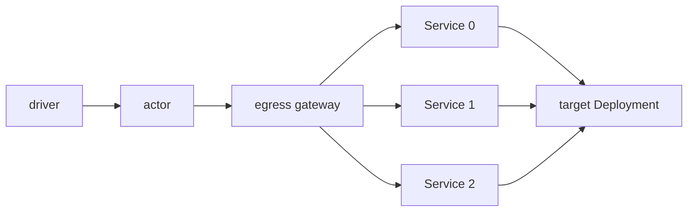
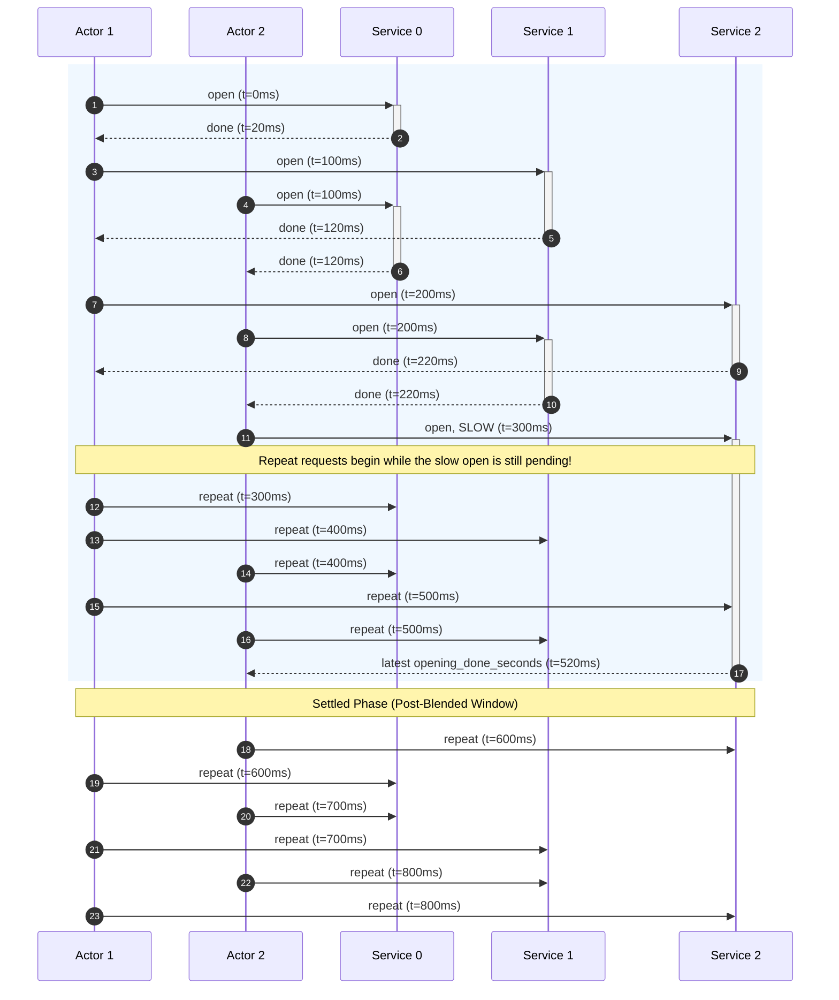

# benchmark-egress

`benchmark-egress` is the workload of the egress scale test. It holds many
CONNECT tunnels open through the egress gateway at a fixed pace and reports what
each tunnel saw, so that a run can price what one tunnel costs the gateway.

## 1. What the benchmark measures

The benchmark sizes one `atenet-egress` replica for a target fleet: A actors,
each reaching C destinations. It reports what one tunnel and one request cost
the gateway, so that the replica count for a fleet follows from fleet size,
node shape, and these costs.

Three terms:

- **Tunnel.** One kept-alive CONNECT from one actor to one destination
  Service, opened by the actor's first request and reused by every later one.
  It is the unit the gateway's cost scales with: a fleet of A actors over C
  Services holds A × C tunnels.
- **Blended.** The window from the first actor's start until the last actor
  has opened its last tunnel. New tunnels are being set up while tunnels
  already open carry repeat requests, so the gateway's CPU mixes setup with
  ordinary requests.
- **Settled.** The period, after the blended window, in which every tunnel
  has been reused and every request reuses one. Nothing is set up; the
  gateway's cost is per request.

The settled period gives the cost of one request directly. The blended window
gives the cost of setting up one tunnel once its requests are priced at the
settled rate.

A cell is one fleet size and one protocol. It reports:

- **Settled req/s per core.** Throughput per gateway core once every tunnel
  exists. Its inverse is the CPU cost of one request.
- **Gateway CPU per tunnel opened.** CPU milliseconds to set up one tunnel, the
  cost of its requests taken out.
- **Envoy heap per tunnel.** KiB of heap one held tunnel adds.
- **Settled p50, p99, p99.9 and success rate.** Latency of repeat requests as
  the actor sees it, and the share that got HTTP 200. Flat across fleet sizes
  means the gateway was not saturated while the costs were read.

The costs price held tunnels, not tunnels that reconnect. Section 5 lists the
checks a cell must pass before its numbers count.

Per-core and per-tunnel figures do not depend on the node size or the replica
count. Memory sizes as tunnel count times heap per tunnel, against one node's
memory. CPU sizes as request rate times CPU per request, plus the rate of
tunnel opens times CPU per tunnel opened, against one node's cores. The
replica count for a fleet is the larger of the two.

## 2. Topology

- **`benchmark-egress actor`** runs inside each Actor. The driver controls it
  through the atenet router on port 80: `/readyz`, `/start`, `/metrics`, `/stop`.
  Once started, it holds one CONNECT tunnel per endpoint through the gateway
  and sends a `GET` on each at a fixed pace. The actor's egress policy must
  name every endpoint hostname. Section 3 has the workflow.
- **Egress gateway.** One `atenet-egress` replica in its sdsmint deployment,
  the system under test. It carries one CONNECT tunnel per actor and
  destination, terminates the actor's TLS on HTTPS runs, and checks the egress
  policy on every request. On HTTPS runs the actor trusts the gateway's MITM
  CA through `SSL_CERT_FILE`, and the gateway re-originates TLS to the target
  and must trust the target CA.
- **Endpoints.** C ClusterIP Services, `egress-target-0` to
  `egress-target-<C-1>`, in namespace `egress-tests-targets`. Each is a
  distinct hostname, so each is its own tunnel.
- **`benchmark-egress target`** runs as one Deployment behind all C Services.
  It answers every `GET /` with a 200 and a small fixed body, over plain HTTP
  and, given a certificate, HTTPS. Each Service maps to its own backend port,
  set with `--listen-ports` and `--tls-listen-ports`. The driver issues the
  HTTPS certificate for `*.egress-tests-targets.svc.cluster.local` from a
  throwaway CA that is name-constrained to
  `egress-tests-targets.svc.cluster.local`.
- **Driver.** Sets up the run, starts the A actors, posts `/start`, scrapes
  `/metrics` and the gateway's stats, and sums the scrapes into the results of
  section 5.

## 3. What the actor does

`GET /readyz` answers 200 as soon as the actor is serving. Every answer the
actor gives carries `Benchmark-Egress-Protocol: 1`; the driver refuses an
actor without it as an image from before this contract. `POST /start` takes
a JSON body:

| Field | Meaning |
|---|---|
| `endpoints` | C, the number of endpoints, 1 to 1024. |
| `intervalMs` | Pacing. Endpoint *i* opens *i* intervals after `/start`; each endpoint is then requested once per period of C × `intervalMs`. Zero sends every endpoint's requests back to back. |
| `scheme` | `http` or `https`; empty means `http`. |
| `requestTimeoutMs` | Bound on one request, handshake included; zero means 5000. |
| `newConnPerRequest` | Dial a new connection for every request instead of keeping one per endpoint. Off in a benchmark run, where the kept tunnel is the point; on in tests that exercise the dial path. |

`/start` answers 204, 400 for a body it rejects, or 409 while a loop is
already running. `/metrics` and `/stop` answer 404 when no loop is running.

The loop then runs one goroutine per endpoint:

1. Wait *i* × interval, so C handshakes do not reach the gateway at once.
2. Send the first `GET` to the endpoint. When it completes, success or not, the
   endpoint counts as opened. When the last endpoint opens, the actor stamps
   `opening_done_seconds`.
3. Send one `GET` per period on a ticker started when the open starts. At most
   one request is in flight per endpoint. A request that outlasts the period
   delays only its own endpoint, whose next request starts as soon as the slow
   one returns.
4. Stop on `POST /stop`, which waits for every goroutine and answers 204. The
   driver scrapes `/metrics` once more before it stops. A request cut off by
   the stop is not counted.

The client keeps one connection per endpoint and never closes it for idling,
so a redial in `connections_opened_total` means the gateway cut the tunnel or a request on it
timed out. The gateway resets a tunnel that stays quiet for its stream idle
timeout, 5 minutes by default, so keep the per-endpoint period, C ×
`intervalMs` between two requests on the same endpoint, under it.

With these rules an actor sends one request per interval throughout the run,
and holds C tunnels.

## 4. What the actor reports

`GET /metrics` serves the loop's instruments as a Prometheus exposition, text
or protobuf by `Accept`. Counters are cumulative since `/start`; durations are
seconds. The per-endpoint families are served only when the scrape asks for
them, `GET /metrics?endpoints=1`, since at C = 1024 they outweigh the rest of
the scrape more than five to one.

| Family | Type, labels | What it counts | Used for |
|---|---|---|---|
| `loop_info` | gauge, `scheme` | Always 1. | The scheme in use. |
| `loop_elapsed_seconds` | gauge | Time since `/start`, set when scraped. | Rates between two polls. |
| `requests_total` | counter, `result` = `success` or `error` | Requests finished; HTTP 200 with no error is a success. | Request rate and success rate. |
| `request_errors_total` | counter, `class` | Failures by class, such as `timeout`, `connection reset`, `HTTP 403`; one series per class seen. | One class per failure mode. |
| `connections_opened_total` | counter | Requests sent on a freshly dialed connection. | One per endpoint is the tunnel. Any more is a reconnect after the gateway cut a tunnel or a request on it timed out. |
| `endpoints_opened_total` | counter | Endpoints whose first request has completed. | Progress of this actor's opens. |
| `opening_done_seconds` | gauge | Elapsed time when the last endpoint opened; zero until then. | Added to this actor's `/start` time, the latest across actors ends the blended window. |
| `rounds` | gauge | Requests completed by the least-visited endpoint. | Two means every tunnel has been reused. |
| `longest_gap_seconds` | gauge | Longest time between two consecutive requests on one endpoint. | Whether any tunnel went quiet long enough to be reset. |
| `opening_seconds` | histogram | Successful first requests. | Tunnel setup latency as the actor sees it, apart from the steady state. |
| `latency_seconds` | histogram | Successful repeat requests. | Settled quantiles, no handshakes in them. |
| `dns_seconds`, `tls_seconds` | histogram | Lookup and handshake times, when the request did one. | Setup costs. |
| `endpoint_requests_total` | counter, `endpoint`, `result` | Per-endpoint requests and failures. `?endpoints=1` only. | Naming a failing tunnel. |
| `endpoint_longest_gap_seconds` | gauge, `endpoint` | Per-endpoint longest gap. `?endpoints=1` only. | Naming a quiet tunnel. |

Counters and gauges are present at zero from the first scrape; a histogram
appears with its first sample. The four histograms share one set of bounds, 20
per decade from 1 µs to 60 s, 157 `le` labels plus `+Inf`, so scrapes from any
number of actors add bucket by bucket and a quantile read from the sum is
within about 12% of the true value. A Prometheus histogram carries a count and
a sum but no maximum, so the report has no run maximum.

## 5. What a run aggregates

The driver implements this section; its own promises, phases and refusals are in
[benchmarking/egress-tunnels/CONTRACT.md](../../../benchmarking/egress-tunnels/CONTRACT.md).

The driver scrapes every actor's `/metrics`, protobuf requested, and pairs the
sum with the gateway's own metrics. Per family, the rule is:

| Rule | Families |
|---|---|
| sum, per label set | `requests_total`, `request_errors_total`, `connections_opened_total`, `endpoints_opened_total`, `rounds`, `endpoint_requests_total` |
| max | `loop_elapsed_seconds`, `opening_done_seconds`, `longest_gap_seconds`, `endpoint_longest_gap_seconds` |
| bucket-wise add | `opening_seconds`, `latency_seconds`, `dns_seconds`, `tls_seconds`: every `le` bucket, the count and the sum |
| first | `loop_info` |

A scrape whose histogram carries `le` labels other than the fixed bounds is
refused, naming the actor, and the sum is left untouched. A protobuf scrape
omits the `+Inf` bucket; its count is the sample count. A quantile is read from
the summed buckets as the upper bound of the bucket that holds the rank; a rank
past the last finite bound reads as over 60 s. A windowed figure is a later
scrape minus an earlier one, bucket by bucket. A count that went down means the
actor restarted, so that window is dropped and the next starts from the later
scrape.

The results of a cell come from two windows. The blended window runs from the
first `/start` to the latest `opening_done_seconds`, each actor's offset by its own
`/start` time. The settled window starts once every actor has opened, every
actor's `rounds` has reached two, checked per actor before the sum, and
`connections_opened_total` is flat between two polls. Two actors and three endpoints, 100 ms
apart, with actor 2 started 100 ms later and its third open slow:

Both actors' first repeats fall inside the blended window, because it ends
when the slowest actor finishes its last open. The gateway's CPU in that window
paid for six tunnel setups and for every request in it; the settled rate prices
every request, the first on each tunnel included, and what is left is the
setups.

| Result | Source | How it is computed |
|---|---|---|
| Settled req/s per gateway core | actors + gateway | Requests completed in the settled window divided by the gateway pod's CPU-seconds in the same window: the kubelet's cAdvisor metric `container_cpu_usage_seconds_total`, summed over the envoy, ext-proc and sdsmint containers. |
| Gateway CPU per tunnel opened | actors + gateway | The blended window's gateway CPU, minus every request in it priced at the settled per-request cost, divided by the tunnels opened. What remains is setup alone, independent of pacing, on the assumption that a request on an open tunnel costs the same in either window. Computed after the settled window, since it needs the settled rate. |
| Envoy heap | gateway | The maximum of `server.memory_allocated` in the cell; per-tunnel cost is the slope across fleet sizes. |
| Settled p50, p99, p99.9 | actors | Read from the difference between two polls of the summed `latency_seconds` histogram. |
| Success rate | actors | `requests_total{result="success"}` over all of `requests_total` for the period. |
| Run validity | actors + gateway | `connections_opened_total` equals `endpoints_opened_total` and stays flat, `longest_gap_seconds` stays under the stream idle timeout, `cluster.mitm_internal.upstream_cx_total` equals A × C and stays flat, and `http.egress_connect.downstream_rq_idle_timeout`, `downstream_cx_idle_timeout` and `downstream_cx_protocol_error` do not move. |
