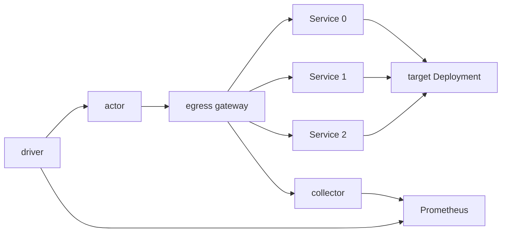

# benchmark-egress

`benchmark-egress` is the workload of the egress scale test. It holds many
CONNECT tunnels open through the egress gateway at a fixed pace and reports what
each tunnel saw, so that a run can price what one tunnel costs the gateway.

## 1. What the benchmark measures

The benchmark sizes one `atenet-egress` replica for a target fleet: A actors,
each reaching C destinations. It reports what one tunnel and one request cost
the gateway, so that the replica count for a fleet follows from fleet size,
node shape, and these costs.

Three terms:

- **Tunnel.** One kept-alive CONNECT from one actor to one destination
  Service, opened by the actor's first request and reused by every later one.
  It is the unit the gateway's cost scales with: a fleet of A actors over C
  Services holds A × C tunnels.
- **Blended.** The window from the first actor's start until the last actor
  has opened its last tunnel. New tunnels are being set up while tunnels
  already open carry repeat requests, so the gateway's CPU mixes setup with
  ordinary requests.
- **Settled.** The period, after the blended window, in which every tunnel
  has been reused and every request reuses one. Nothing is set up; the
  gateway's cost is per request.

The settled period gives the cost of one request directly. The blended window
gives the cost of setting up one tunnel once its requests are priced at the
settled rate.

A cell is one fleet size and one protocol. It reports:

- **Settled req/s per core.** Throughput per gateway core once every tunnel
  exists. Its inverse is the CPU cost of one request.
- **Gateway CPU per tunnel opened.** CPU milliseconds to set up one tunnel, the
  cost of its requests taken out.
- **Envoy heap per tunnel.** KiB of heap one held tunnel adds.
- **Settled p50, p99, p99.9 and success rate.** Latency of repeat requests as
  the actor sees it, and the share that got HTTP 200. Flat across fleet sizes
  means the gateway was not saturated while the costs were read.

The costs price held tunnels, not tunnels that reconnect. Section 5 lists the
checks a cell must pass before its numbers count.

Per-core and per-tunnel figures do not depend on the node size or the replica
count. Memory sizes as tunnel count times heap per tunnel, against one node's
memory. CPU sizes as request rate times CPU per request, plus the rate of
tunnel opens times CPU per tunnel opened, against one node's cores. The
replica count for a fleet is the larger of the two.

## 2. Topology



- **`benchmark-egress actor`** runs inside each Actor. The driver controls it
  through the atenet router on port 80: `/readyz`, `/start`, `/stats`,
  `/stop`. Once started, it holds one CONNECT tunnel per endpoint through the
  gateway and sends a `GET` on each at a fixed pace, and it exports what it
  measures as OpenTelemetry metrics over OTLP, through the same gateway, to the
  collector named by its environment. The actor's egress policy must name every
  endpoint hostname and the collector. Section 3 has the workflow, section 4
  the metrics.
- **Egress gateway.** One `atenet-egress` replica in its sdsmint deployment,
  the system under test. It carries one CONNECT tunnel per actor and
  destination, plus one per actor to the collector, terminates the actor's TLS
  on HTTPS runs, and checks the egress policy on every request. On HTTPS runs
  the actor trusts the gateway's MITM CA through `SSL_CERT_FILE`, and the
  gateway re-originates TLS to the target and must trust the target CA.
- **Endpoints.** C ClusterIP Services, `egress-target-0` to
  `egress-target-<C-1>`, in namespace `egress-tests-targets`. Each is a
  distinct hostname, so each is its own tunnel.
- **`benchmark-egress target`** runs as one Deployment behind all C Services.
  It answers every `GET /` with a 200 and a small fixed body, over plain HTTP
  and, given a certificate, HTTPS. Each Service maps to its own backend port,
  set with `--listen-ports` and `--tls-listen-ports`. The driver issues the
  HTTPS certificate for `*.egress-tests-targets.svc.cluster.local` from a
  throwaway CA that is name-constrained to
  `egress-tests-targets.svc.cluster.local`.
- **Collector and Prometheus.** An OpenTelemetry collector that receives the
  actors' OTLP on port 4317 and serves it as a Prometheus exposition, and a
  Prometheus that scrapes it and the gateway node's cAdvisor. Both belong to
  the benchmark's deployment, not to the actor. The actor only needs the
  collector's address.
- **Driver.** Sets up the run, starts the A actors, posts `/start`, polls
  `/stats` for the gates, records the instants that bound each window, and
  reads every result from Prometheus with the queries of section 5.

## 3. What the actor does

The actor is idle or running. It boots idle and sends nothing until `/start`:
every actor restores from a golden snapshot, and a loop started at boot would
have run in the golden actor, which has no egress policy. A restarted actor is
idle again with nothing kept.

| Route | Idle | Running |
|---|---|---|
| `GET /readyz` | 200 | 200 |
| `POST /start` | 204 | 409 |
| `GET /stats` | 404 | 200, section 4 |
| `POST /stop` | 200 with the last loop's final counters, 404 if none | 200 with the final counters once every goroutine has exited |

Every answer carries `Benchmark-Egress-Protocol: 1`; the driver requires that
value, and the header is what lets a later contract be refused.

`POST /start` takes one JSON object, at most 1 MiB; unknown fields are ignored.

| Field | Meaning | 400 when |
|---|---|---|
| `endpoints` | C, the number of endpoints. | Missing, under 1, or over 1024. |
| `intervalMs` | Pacing. Endpoint *i* opens *i* intervals after `/start`; each endpoint is then requested once per period of C × `intervalMs`. Zero sends every endpoint's requests back to back. | Negative. |
| `offsetMs` | Delay before endpoint 0 opens; endpoint *i* opens `offsetMs` + *i* × `intervalMs` after `/start`. Lets a driver give each actor its own phase, so a fleet started at once does not send in lockstep; see below for how a driver picks it. | Negative, or more than C × `intervalMs`. |
| `scheme` | `http` or `https`; empty means `http`. | Any other value. |
| `requestTimeoutMs` | Bound on one request, handshake included; zero means 5000. | Negative. |

```json
{"endpoints": 1000, "intervalMs": 100, "scheme": "https"}
```

204 means the goroutines exist, not that any request has been sent. A 400
carries a one-line reason. `/start` does not probe the endpoints: a missing
egress policy or Service shows up as errors in `/stats`, not as a failed
`/start`. The instruments are created at `/start` and released at `/stop`, so
every counter counts from `/start` and a later `/start` begins from zero.

## 4. What the actor reports

### 4.1 `GET /stats` and `POST /stop`

Durations are Go `time.Duration` values, nanoseconds. The per-endpoint list
comes only with `?endpoints=1`, on either route.

| Field | What it holds | Used for |
|---|---|---|
| `scheme` | `http` or `https`. | The scheme in use. |
| `elapsed` | Time since `/start`. | Rates between two polls. |
| `requests`, `successes` | Requests finished; HTTP 200 with no error is a success. | Progress; a `requests` that went down means a restart. |
| `newConns` | Requests sent on a freshly dialed connection. | One per endpoint is the tunnel. Any more is a reconnect after the gateway cut a tunnel or a request on it timed out. |
| `opened` | Endpoints whose first request has completed. | Progress of this actor's opens; the gate on C. |
| `openingDone` | Elapsed when the last endpoint opened; zero until then. | Added to this actor's `/start` time, the latest across actors ends the blended window. |
| `requestsAtOpeningDone` | `requests` at that same moment; zero until then. | This actor's request count for its own opening, section 5. |
| `rounds` | Requests completed by the least-visited endpoint. | Two means every tunnel has been reused; the settled gate. |
| `longestGap` | Longest time between two consecutive requests on one endpoint. | Whether any tunnel went quiet long enough to be reset. |
| `errors` | Failures by class, such as `timeout`, `connection reset`, `HTTP 403`; one entry per class seen. | One class per failure mode. |
| `endpoints` | Per endpoint, by number: `requests`, `errors`, `longestGap`. `?endpoints=1` only. | Naming a failing or quiet tunnel. |

At C = 1024 a `/stats` is about 250 bytes and the endpoint list about 60 KB
more.

```json
{
  "scheme": "https", "elapsed": 612000000000,
  "requests": 61440, "successes": 61437, "newConns": 1024, "opened": 1024,
  "openingDone": 102400000000, "requestsAtOpeningDone": 1536,
  "rounds": 60, "longestGap": 102600000000,
  "errors": {"timeout": 3}
}
```
