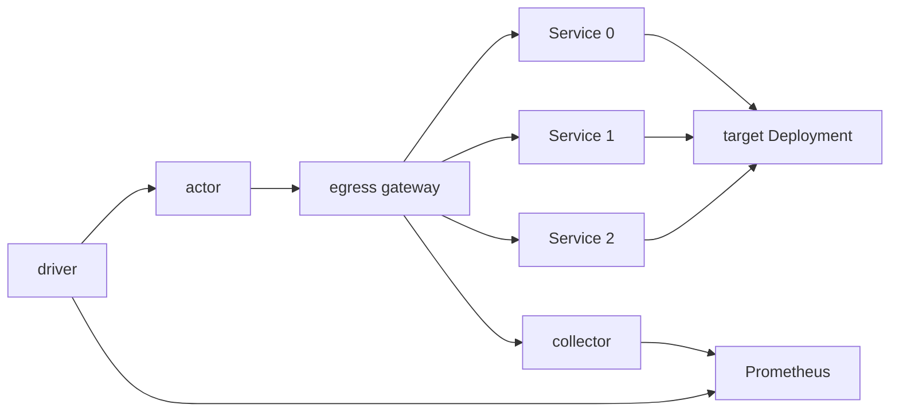
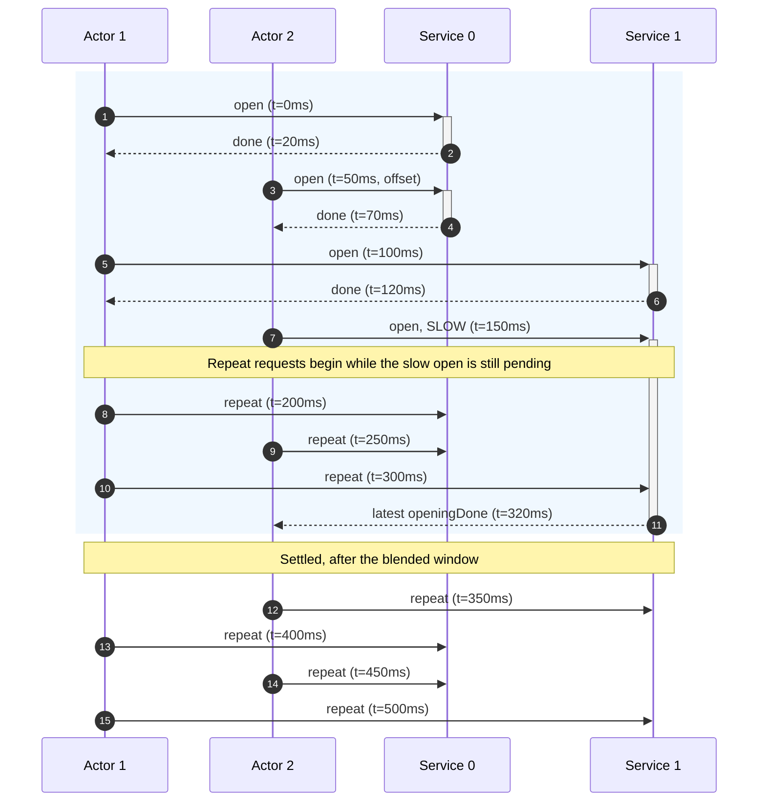

# benchmark-egress

`benchmark-egress` is the workload of the egress scale test. It holds many
CONNECT tunnels open through the egress gateway at a fixed pace and reports what
each tunnel saw, so that a run can price what one tunnel costs the gateway.

## 1. What the benchmark measures

The benchmark sizes one `atenet-egress` replica for a target fleet: A actors,
each reaching C destinations. It reports what one tunnel and one request cost
the gateway, so that the replica count for a fleet follows from fleet size,
node shape, and these costs.

Three terms:

- **Tunnel.** One kept-alive CONNECT from one actor to one destination
  Service, opened by the actor's first request and reused by every later one.
  It is the unit the gateway's cost scales with: a fleet of A actors over C
  Services holds A × C tunnels.
- **Blended.** The window from the first actor's start until the last actor
  has opened its last tunnel. New tunnels are being set up while tunnels
  already open carry repeat requests, so the gateway's CPU mixes setup with
  ordinary requests.
- **Settled.** The period, after the blended window, in which every tunnel
  has been reused and every request reuses one. Nothing is set up; the
  gateway's cost is per request.

The settled period gives the cost of one request directly. The blended window
gives the cost of setting up one tunnel once its requests are priced at the
settled rate.

A cell is one fleet size and one protocol. It reports:

- **Settled req/s per core.** Throughput per gateway core once every tunnel
  exists. Its inverse is the CPU cost of one request.
- **Gateway CPU per tunnel opened.** CPU milliseconds to set up one tunnel, the
  cost of its requests taken out.
- **Envoy heap per tunnel.** KiB of heap one held tunnel adds.
- **Settled p50, p99, p99.9 and success rate.** Latency of repeat requests as
  the actor sees it, and the share that got HTTP 200. Flat across fleet sizes
  means the gateway was not saturated while the costs were read.

The costs price held tunnels, not tunnels that reconnect. Section 5 lists the
checks a cell must pass before its numbers count.

Per-core and per-tunnel figures do not depend on the node size or the replica
count. Memory sizes as tunnel count times heap per tunnel, against one node's
memory. CPU sizes as request rate times CPU per request, plus the rate of
tunnel opens times CPU per tunnel opened, against one node's cores. The
replica count for a fleet is the larger of the two.

## 2. Topology



- **`benchmark-egress actor`** runs inside each Actor. The driver controls it
  through the atenet router on port 80: `/readyz`, `/start`, `/stats`,
  `/stop`. Once started, it holds one CONNECT tunnel per endpoint through the
  gateway and sends a `GET` on each at a fixed pace, and it exports what it
  measures as OpenTelemetry metrics over OTLP, through the same gateway, to the
  collector named by its environment. The actor's egress policy must name every
  endpoint hostname and the collector. Section 3 has the workflow, section 4
  the metrics.
- **Egress gateway.** One `atenet-egress` replica in its sdsmint deployment,
  the system under test. It carries one CONNECT tunnel per actor and
  destination, plus one per actor to the collector, terminates the actor's TLS
  on HTTPS runs, and checks the egress policy on every request. On HTTPS runs
  the actor trusts the gateway's MITM CA through `SSL_CERT_FILE`, and the
  gateway re-originates TLS to the target and must trust the target CA.
- **Endpoints.** C ClusterIP Services, `egress-target-0` to
  `egress-target-<C-1>`, in namespace `egress-tests-targets`. Each is a
  distinct hostname, so each is its own tunnel.
- **`benchmark-egress target`** runs as one Deployment behind all C Services.
  It answers every `GET /` with a 200 and a small fixed body, over plain HTTP
  and, given a certificate, HTTPS. Each Service maps to its own backend port,
  set with `--listen-ports` and `--tls-listen-ports`. The driver issues the
  HTTPS certificate for `*.egress-tests-targets.svc.cluster.local` from a
  throwaway CA that is name-constrained to
  `egress-tests-targets.svc.cluster.local`.
- **Collector and Prometheus.** An OpenTelemetry collector that receives the
  actors' OTLP on port 4317 and serves it as a Prometheus exposition, and a
  Prometheus that scrapes it and the gateway node's cAdvisor. Both belong to
  the benchmark's deployment, not to the actor. The actor only needs the
  collector's address.
- **Driver.** Sets up the run, starts the A actors, posts `/start`, polls
  `/stats` for the gates, records the instants that bound each window, and
  reads every result from Prometheus with the queries of section 5.

## 3. What the actor does

The actor is idle or running. It boots idle and sends nothing until `/start`:
every actor restores from a golden snapshot, and a loop started at boot would
have run in the golden actor, which has no egress policy. A restarted actor is
idle again with nothing kept.

| Route | Idle | Running |
|---|---|---|
| `GET /readyz` | 200 | 200 |
| `POST /start` | 204 | 409 |
| `GET /stats` | 404 | 200, section 4 |
| `POST /stop` | 200 with the last loop's final counters, 404 if none | 200 with the final counters once every goroutine has exited and the last export is out |

Every answer carries `Benchmark-Egress-Protocol: 1`; the driver requires that
value, and the header is what lets a later contract be refused.

`POST /start` takes one JSON object, at most 1 MiB; unknown fields are ignored.

| Field | Meaning | 400 when |
|---|---|---|
| `endpoints` | C, the number of endpoints. | Missing, under 1, or over 1024. |
| `intervalMs` | Pacing. Endpoint *i* opens *i* intervals after `/start`; each endpoint is then requested once per period of C × `intervalMs`. Zero sends every endpoint's requests back to back. | Negative. |
| `offsetMs` | Delay before endpoint 0 opens; endpoint *i* opens `offsetMs` + *i* × `intervalMs` after `/start`. Lets a driver give each actor its own phase, so a fleet started at once does not send in lockstep; see below for how a driver picks it. | Negative, or more than C × `intervalMs`. |
| `scheme` | `http` or `https`; empty means `http`. | Any other value. |
| `requestTimeoutMs` | Bound on one request, handshake included; zero means 5000. | Negative. |
| `actor` | This actor's name, `<atespace>/<name>`. An attribute on every metric the loop exports; the fleet's series are told apart by it. | Missing. |
| `cell` | The cell this loop belongs to. An attribute on every metric. | Missing. |
| `run` | The run the cell belongs to. An attribute on every metric; a rerun of a cell gets a new `run`. | Missing. |

```json
{"endpoints": 1000, "intervalMs": 100, "scheme": "https",
 "actor": "benchmark-workloads/egress-0017", "cell": "1000x1000-https", "run": "20261022-1"}
```

204 means the goroutines exist, not that any request has been sent. A 400
carries a one-line reason. `/start` does not probe the endpoints or the
collector: a missing egress policy or Service shows up as errors in `/stats`,
not as a failed `/start`, and a collector that cannot be reached shows up as
absent series in Prometheus. The instruments are created at `/start` and
released at `/stop`, so every counter counts from `/start` and a later `/start`
begins from zero under a new instance id.

The loop then runs one goroutine per endpoint:

1. Wait offset + *i* × interval, so C handshakes do not reach the gateway at
   once.
2. Send the first `GET` to the endpoint. When it completes, success or not, the
   endpoint counts as opened. When the last endpoint opens, the actor stamps
   `openingDone`.
3. Send one `GET` per period on a ticker started when the open starts. At most
   one request is in flight per endpoint. A request that outlasts the period
   delays only its own endpoint, whose next request starts as soon as the slow
   one returns.
4. Stop on `POST /stop`, which waits for every goroutine, flushes the last
   export, and answers with the final counters of section 4. A request cut off
   by the stop is not counted. The actor keeps those counters until the next
   `/start`, so a `/stop` whose answer was lost is asked again and answered
   again.

The client keeps one connection per endpoint and never closes it for idling,
so a redial, one more in `newConns`, means the gateway cut the tunnel or a
request on it timed out. The gateway resets a tunnel that stays quiet for its stream idle
timeout, 5 minutes by default, so keep the per-endpoint period, C ×
`intervalMs` between two requests on the same endpoint, under it.

Only an actor's phase modulo `intervalMs` matters to the fleet: once started
it sends at `/start` + `offsetMs` + k × `intervalMs`. A driver gives actor k
of A `offsetMs` = ⌊k × `intervalMs` / A⌋, which spreads the phases evenly; a
uniform draw from [0, `intervalMs`) does about as well but needs its seed
recorded. Four actors with `intervalMs` 100:

| Offsets | Fleet sends in each interval |
|---|---|
| 0, 0, 0, 0 | 4 at 0 ms |
| 0, 25, 50, 75 | 1 at 0, 25, 50, 75 ms |

The offset lives on the actor because the router's fan-out of `/start` sets
each actor's real phase, and the driver does not control it.

With these rules an actor sends one request per interval throughout the run,
and holds C tunnels.

## 4. What the actor reports

The actor reports on two paths. `GET /stats` answers one small JSON object,
the counters cumulative since `/start`, for a driver's gates and progress:
poll it, it consumes nothing. Everything a result is computed from, the same
counters and the four latency distributions, the actor exports as
OpenTelemetry metrics over OTLP to the collector, once per export interval, and
the driver reads them from Prometheus. The actor keeps no window state: it has
no cut to serve and nothing to replay, so a lost export costs one interval of
staleness and nothing else.

### 4.1 `GET /stats` and `POST /stop`

Durations are Go `time.Duration` values, nanoseconds. The per-endpoint list
comes only with `?endpoints=1`, on either route.

| Field | What it holds | Used for |
|---|---|---|
| `scheme` | `http` or `https`. | The scheme in use. |
| `elapsed` | Time since `/start`. | Rates between two polls. |
| `requests`, `successes` | Requests finished; HTTP 200 with no error is a success. | Progress; a `requests` that went down means a restart. |
| `newConns` | Requests sent on a freshly dialed connection. | One per endpoint is the tunnel. Any more is a reconnect after the gateway cut a tunnel or a request on it timed out. |
| `opened` | Endpoints whose first request has completed. | Progress of this actor's opens; the gate on C. |
| `openingDone` | Elapsed when the last endpoint opened; zero until then. | Added to this actor's `/start` time, the latest across actors ends the blended window. |
| `requestsAtOpeningDone` | `requests` at that same moment; zero until then. | This actor's request count for its own opening, section 5. |
| `rounds` | Requests completed by the least-visited endpoint. | Two means every tunnel has been reused; the settled gate. |
| `longestGap` | Longest time between two consecutive requests on one endpoint. | Whether any tunnel went quiet long enough to be reset. |
| `errors` | Failures by class, such as `timeout`, `connection reset`, `HTTP 403`; one entry per class seen. | One class per failure mode. |
| `endpoints` | Per endpoint, by number: `requests`, `errors`, `longestGap`. `?endpoints=1` only. | Naming a failing or quiet tunnel. |

At C = 1024 a `/stats` is about 250 bytes and the endpoint list about 60 KB
more.

```json
{
  "scheme": "https", "elapsed": 612000000000,
  "requests": 61440, "successes": 61437, "newConns": 1024, "opened": 1024,
  "openingDone": 102400000000, "requestsAtOpeningDone": 1536,
  "rounds": 60, "longestGap": 102600000000,
  "errors": {"timeout": 3}
}
```

### 4.2 Metrics

The loop records with these instruments. Names are chosen so that the
collector's Prometheus exporter serves exactly the series the queries of
section 5 read: a counter gains `_total`, a unit of seconds gains `_seconds`,
a histogram gains `_bucket`, `_sum` and `_count`.

| Instrument | Kind, unit | Attributes | Prometheus series | What it holds |
|---|---|---|---|---|
| `requests` | counter | `result` = `success` or `error` | `requests_total` | Requests finished, by outcome. |
| `request_errors` | counter | `class` | `request_errors_total` | Failures by class, as `errors` in `/stats`. |
| `connections_opened` | counter | | `connections_opened_total` | Requests sent on a freshly dialed connection, as `newConns`. |
| `endpoints_opened` | counter | | `endpoints_opened_total` | Endpoints whose first request completed, as `opened`. |
| `rounds` | gauge | | `rounds` | Requests completed by the least-visited endpoint. |
| `opening_done` | gauge, s | | `opening_done_seconds` | Seconds from `/start` to the last open; zero until then. |
| `longest_gap` | gauge, s | | `longest_gap_seconds` | Longest gap between two requests on one endpoint. |
| `opening` | histogram, s | | `opening_seconds_*` | Successful first requests: tunnel setup latency. |
| `latency` | histogram, s | | `latency_seconds_*` | Successful repeat requests: the settled quantiles, no handshakes in them. |
| `dns`, `tls` | histogram, s | | `dns_seconds_*`, `tls_seconds_*` | Lookup and handshake times, when a request did one. Both stop moving once every tunnel is up. |

Every point carries `actor`, `cell` and `run` from `/start`. The resource is
`service.name` = `benchmark-egress-actor`, the actor's default unless
`OTEL_RESOURCE_ATTRIBUTES` sets another, which the exporter writes as `job`,
and `service.instance.id`, which the actor draws at `/start`, so a restarted
actor is a new `instance` and never continues the old series. The per-endpoint
rows are not exported: at C = 1024 across a thousand actors they would be three
million series. They stay on `/stats?endpoints=1` for a person debugging one
actor.

The histograms share one set of bounds, 20 per decade from 1 µs to 63.1 s,
157 values, the same in every actor and every image, so `sum by (le)` across
the fleet is meaningful. Neighboring bounds differ by about 12%, which sets the
resolution: a quantile is within one bucket step of the true value, and two
runs whose quantiles fall within one step are indistinguishable. There is no
exact maximum; the overflow bucket is the last.

One actor exports 646 series, about 90 KB of protobuf per interval. A fleet of
a thousand at the default interval is 646 thousand series and 130 thousand
points per second into the collector, and one more CONNECT tunnel per actor
through the gateway.

### 4.3 Export

The actor is configured by the standard OpenTelemetry environment, set on the
ActorTemplate:

| Variable | Value | Meaning |
|---|---|---|
| `OTEL_EXPORTER_OTLP_ENDPOINT` | `http://<collector>:4317` | Where to push, OTLP over gRPC, plaintext. Unset means the loop exports nothing and `/start` still works. |
| `OTEL_RESOURCE_ATTRIBUTES` | `service.name=benchmark-egress-actor` | The `job` the series are stored under. Optional: this value is the actor's default, and the variable overrides it. |
| `OTEL_METRIC_EXPORT_INTERVAL` | `5000` | Milliseconds between exports; the default of the SDK is 60000, too coarse for a window of a few minutes. |
| `OTEL_METRIC_EXPORT_TIMEOUT` | `5000` | A failed export must not delay the next. |

Temporality is cumulative, the SDK's default, which is what the collector's
Prometheus exporter expects. The push goes through the egress gateway like
every other byte the actor sends, so the actor's egress policy needs one more
rule, cleartext HTTP to the collector on its port:

```yaml
- http:
    hostnames:
    - telemetry-meter.benchmarking.svc.cluster.local
    - telemetry-meter.benchmarking.svc
    - telemetry-meter.benchmarking
    ports:
      numbers: [4317]
```

Both the full name and the short forms are needed: the sandbox's resolver
completes the short name to the full one, which the DNS relay forwards only
when a rule names it, while the gateway matches the request's authority, which
is the short name the SDK dialed. A rule without `ports` admits port 80 only.

## 5. What a run aggregates

The driver is the next PR. This section is the contract it implements.

The driver polls every actor's `/stats` for the gates and records four
instants: `t0`, the first `/start`; `t1`, when every actor's `opened` is C,
the end of the blended window; `t2`, when every actor's `rounds` is at least
two and `newConns` is flat between two polls, the start of the settled window;
`t3`, `t2` plus the cell's duration, when it posts `/stop`. Every result is a
difference between two instants, read from Prometheus with the instant query
API, `time=` set to the later instant and the earlier one as an `@` anchor, so
the query is about the instants and not about when the driver asked. The
driver reads at `t` plus a lag of one export interval, one scrape interval and
a margin, so the samples at `t` exist.

Series selector `S` is `{job="benchmark-egress-actor", cell="<cell>", run="<run>"}`.
The merge across actors happens in the query:

| Rule | Series |
|---|---|
| `sum` of `@`-differences | `requests_total`, `request_errors_total`, `connections_opened_total`, `endpoints_opened_total`, `latency_seconds_count`, `latency_seconds_sum` |
| `sum by (le)` of `@`-differences, then `histogram_quantile` | `latency_seconds_bucket`, `opening_seconds_bucket` |
| `max` | `opening_done_seconds`, `longest_gap_seconds` |
| `min` | `rounds` |
| `count by (actor)` | presence: every actor's series exist at both instants |

| Result | Query at `time=t_end` |
|---|---|
| Requests in a window | `sum(requests_total S) - (sum(requests_total S @ t_start) or vector(0))` |
| Success rate | the same pair with `result="success"`, over the total |
| Settled p50, p99, p99.9 | `histogram_quantile(q, sum by (le) (latency_seconds_bucket S) - (sum by (le) (latency_seconds_bucket S @ t_start) or sum by (le) (latency_seconds_bucket S) * 0))` |
| Blended end | per actor, its `/start` time plus `opening_done_seconds`; the latest is `t1` |
| Gateway CPU in a window | `sum(container_cpu_usage_seconds_total{pod=~"atenet-egress.*", container=~"envoy|ext-proc|sdsmint"})` as the same `@`-difference, from the cAdvisor scrape of the gateway's node |
| Presence | `count(count by (actor) (requests_total S)) == A` at `t2` and `t3` |

`rate` and `increase` are not used for results: they extrapolate over the
range and lose the first sample. They serve only the collector's own counters.

The results of a cell come from two windows. The blended window runs from the
first `/start` to the latest `openingDone`, each actor's shifted by its own
`/start` time. An actor's `openingDone` counts from its `/start`, so each
actor's window also covers its `offsetMs`. The settled window starts once
every actor has opened, every actor's `rounds` has reached two, checked per
actor before the sum, and `newConns` is flat between two polls. Two actors and
two endpoints, 100 ms apart, both started at the same time, actor 2 with a
50 ms offset and a slow second open:



Both actors' first repeats fall inside the blended window, because it ends
when the slowest actor finishes its last open. The offset puts actor 2's sends
halfway between actor 1's, so the two together send one request every 50 ms
rather than two every 100 ms; without it every send of actor 2 would coincide
with one of actor 1's. The gateway's CPU in that window paid for four tunnel
setups and for every request in it; the settled rate prices every request, the
first on each tunnel included, and what is left is the setups. `t1` is the
edge the driver reads the gateway's CPU against, and the `@`-difference of
`requests_total` over `t0..t1` is the window's request count;
`requestsAtOpeningDone`, summed from `/stats`, is the count at each actor's
own opening end, for the opening alone.

| Result | Source | How it is computed |
|---|---|---|
| Settled req/s per gateway core | actors + gateway | Requests completed in the settled window divided by the gateway pod's CPU-seconds in the same window, both as `@`-differences over `t2..t3` from the same Prometheus. |
| Gateway CPU per tunnel opened | actors + gateway | The blended window's gateway CPU, minus every request in it priced at the settled per-request cost, divided by the tunnels opened. What remains is setup alone, independent of pacing, on the assumption that a request on an open tunnel costs the same in either window. Computed after the settled window, since it needs the settled rate. |
| Envoy heap | gateway | The maximum of `server.memory_allocated` in the cell; per-tunnel cost is the slope across fleet sizes. |
| Settled p50, p99, p99.9 | actors | `histogram_quantile` on the settled window's bucket differences, reported as interpolated with a bucket resolution of 12%. |
| Success rate | actors | `result="success"` over all `requests_total` in the window. |
| Run validity | actors + gateway | `endpoints_opened_total` equals A × C and `connections_opened_total` does not move over `t2..t3` (a first request that failed counts its endpoint as opened and dials its tunnel one period later, so the two counters need not be equal); `max(longest_gap_seconds)` stays under the stream idle timeout; `dns_seconds_count` and `tls_seconds_count` do not move over `t2..t3`; presence is A at `t2` and `t3`; `cluster.mitm_internal.upstream_cx_total` equals A × (C + 1) and stays flat; `http.egress_connect.downstream_rq_idle_timeout`, `downstream_cx_idle_timeout` and `downstream_cx_protocol_error` do not move; the collector's `otelcol_receiver_refused_metric_points` does not move. |

Three limits of this design are accepted and stated here rather than worked
around:

- **Instant reads lag.** A sample at `t` holds what the actor exported up to
  one export interval before `t`, scraped up to one scrape interval later. In
  a difference between two instants of a steady window the lag is the same at
  both ends and cancels; measured on GKE, a 300 s settled window agreed with
  exact cuts within 0.1% of requests. Where the rate changes between the
  instants, at the start, the stop, or a restart, the error is up to export
  plus scrape interval per end.
- **A restart inside a window invalidates the cell.** A `requests` that went
  down between two `/stats` polls, or a 404, means the actor restarted. Its new
  instance starts from zero under the same `actor`; the old instance's series
  stop and expire from the collector after its expiration time. The driver
  marks the cell invalid rather than reasoning about the overlap.
- **No maximum.** The histogram carries no exact maximum; the largest latency
  is known to one bucket step.
